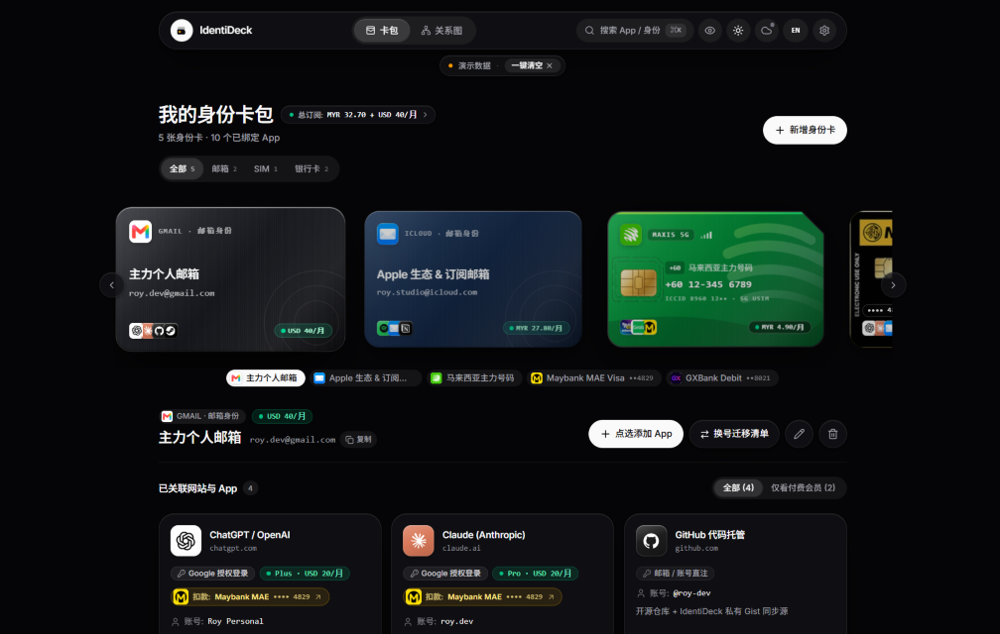
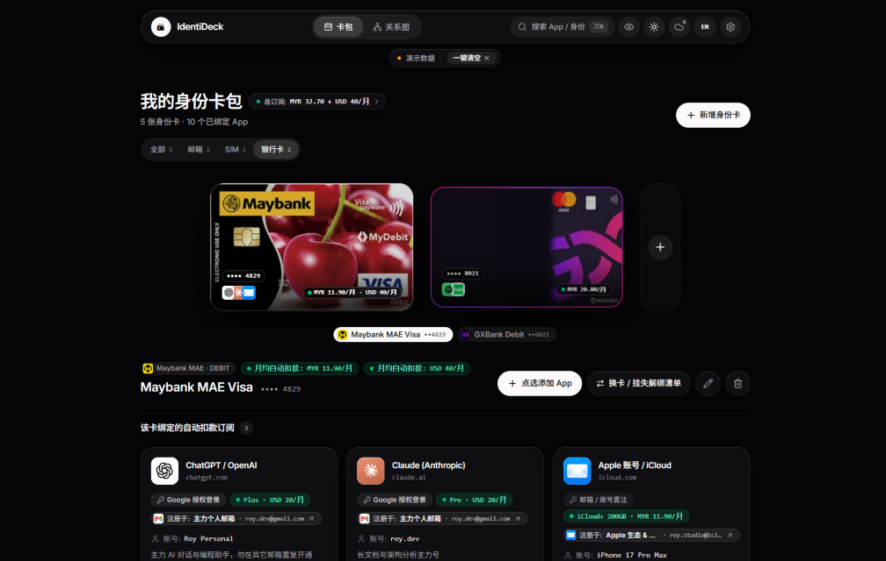
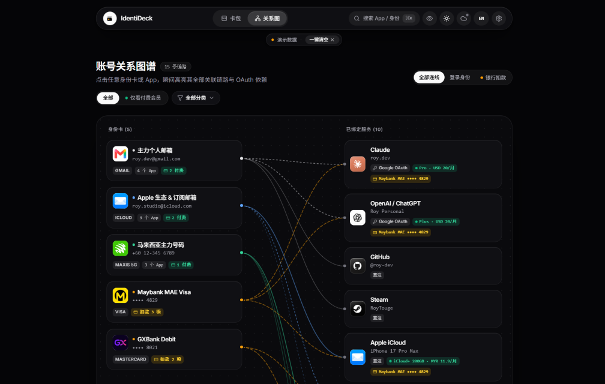
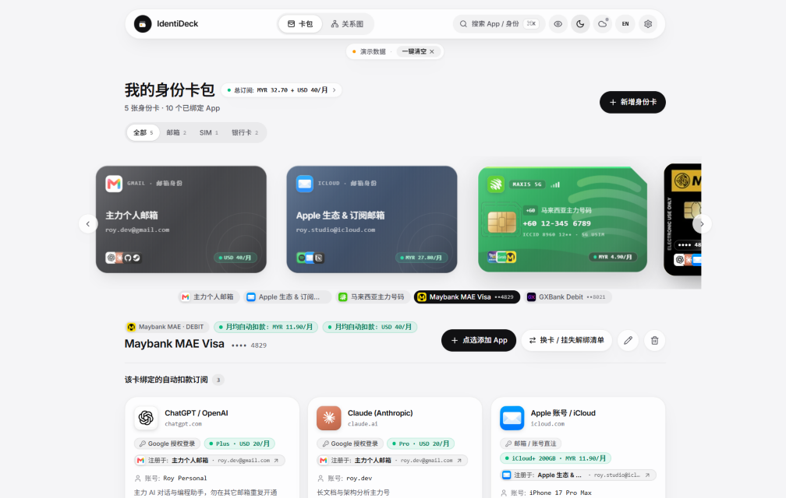
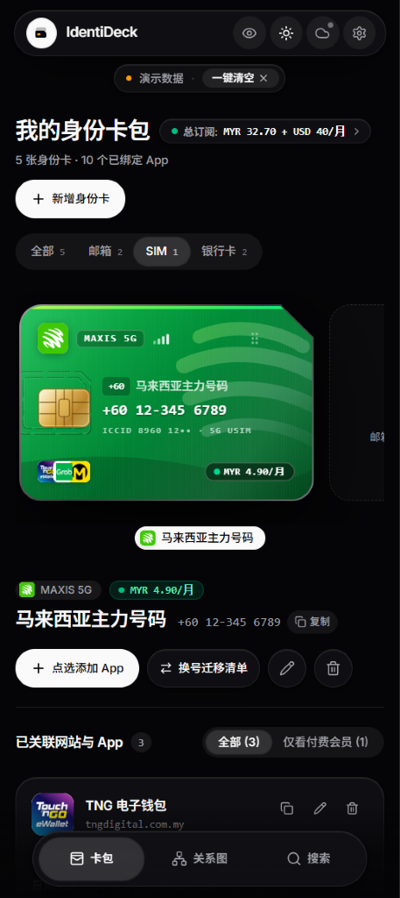

<div align="center">

# IdentiDeck · 身份卡包

**Apple Wallet 极简拟物账号身份、5G SIM 与银行卡订阅图谱 PWA**  
**Apple Wallet-Style Account Identity, 5G SIM & Bank Card Subscription Vault PWA**


[**界面实拍 / Screenshots**](#-界面实拍--screenshots) · [**简体中文**](#-简体中文) · [**English**](#-english)

<br />



*Apple Wallet 风格身份卡包全景（深色模式）· Gmail / iCloud 官方图标 + 1:1 Maxis 5G 三合一实体 SIM + 1:1 实体银行卡*  
*Apple Wallet-style Identity Deck (Dark Mode) · Official Gmail & iCloud logos + 1:1 Maxis 5G Triple-Cut SIM + 1:1 Physical Bank Cards*

</div>

---

## 📸 界面实拍 / Screenshots

<table>
  <tr>
    <td align="center" width="50%">
      
      <br />
      <b>1:1 真实实体银行卡 & 自动扣款追踪</b><br />
      <sub>1:1 Physical Bank Cards (Maybank MAE & GXBank) & Auto-Debit Subscriptions</sub>
    </td>
    <td align="center" width="50%">
      
      <br />
      <b>双链路账号关系图谱（登录身份 + 银行扣款）</b><br />
      <sub>Dual-Link Relationship Graph (Login Identities + Bank Auto-Debit Curves)</sub>
    </td>
  </tr>
  <tr>
    <td align="center" width="50%">
      
      <br />
      <b>极简陶瓷白浅色模式（View Transitions 扩散切换）</b><br />
      <sub>Ceramic Light Mode (Smooth Circular View Transitions Theme Toggle)</sub>
    </td>
    <td align="center" width="50%">
      
      <br />
      <b>iPhone 17 Pro Max 实机全屏 PWA & 1:1 实体 SIM</b><br />
      <sub>iPhone 17 Pro Max Standalone PWA (430×932 Safe Area & 1:1 Triple-Cut SIM)</sub>
    </td>
  </tr>
</table>

---

## 🇨🇳 简体中文

### 核心解决什么痛点？

传统密码管理器帮你存密码，但很难在 1 秒内回答这三个高频问题：
1. **「我的某个邮箱 / 马来西亚 `+60` 手机号到底注册了哪些 App？」**
2. **「这个 App 当初是邮箱直注，还是 `Sign in with Google` / `Apple ID` 授权登录？」**
3. **「ChatGPT Plus / Claude Pro / Spotify 到底绑在哪张银行卡自动扣款？换卡或挂失时有哪些订阅必须改绑？」**

**IdentiDeck（身份卡包）** 专注记录「**身份（邮箱 / SIM 卡） ↔ 扣款银行卡 ↔ App 服务 ↔ OAuth 登录链路 ↔ 付费订阅**」的清晰双链路图谱，在类型层与运行时严格禁止保存任何密码、完整卡号或 CVV/PIN（零密码 & 零敏感卡密策略）。

---

### 核心亮点

- **1:1 真实实体卡片 & 本地官方高清 Logo 体系（离线零 404）**
  - **52 家银行 & 数字银行**：覆盖马来西亚 30 家（含全部 5 家 BNM 持牌数字银行 `GXBank / AEON Bank / Boost Bank / Ryt Bank / KAF Digital Bank`）+ 13 家国际/新加坡银行 + 9 家中国主流银行；内置 **52 个本地 128×128 App Store 官方高清 Logo** 与 **46 张真实实体银行卡面**，支持 3D 倾斜反光、Wise/KAF/Bank Rakyat 侧边盲文缺口、GXBank 紫红彩边与防遮挡底栏。
  - **11 家实体三合一 5G USIM 手机卡**：覆盖 `Maxis / Hotlink / CelcomDigi / U Mobile / Unifi / Yes 5G / Tune Talk / Singtel / 中国移动 / 中国联通 / 中国电信`，1:1 还原实体 PVC 卡体（含珍珠白卡体与品牌丝印）、三合一（Standard / Micro / Nano）压模冲切凹槽、金色 ISO-7816 芯片、公开 ICCID 号段与官方高清运营商 Logo。
  - **10 家主流邮箱官方 Logo**：`Gmail / iCloud / Outlook / Proton / QQ 邮箱 / 网易 163 / Yahoo / Zoho / Fastmail / Tuta`，支持邮箱域名智能识别、拖拽重排（`@dnd-kit`）与 6 秒撤销删除恢复栈。
- **双链路实时关系图谱（`RelationshipGraph`）**
  - 左列邮箱 / SIM / 银行卡 ↔ 右列绑定服务，同步绘制「登录身份链路」与「银行卡自动扣款链路」光滑三次贝塞尔曲线；支持按「全部 / 登录身份 / 银行扣款」与分类筛选，点击任意节点即刻隔离高亮完整路径。
- **154 个内置三栖服务库 + 订阅支出雷达**
  - 完整覆盖 **马来西亚本地**（TNG eWallet、Grab、Maybank MAE、CIMB OCTO、GXBank、Shopee MY、Boost、Setel 等）、**AI 与开发**（ChatGPT、Claude、Gemini、GitHub、Cursor、Vercel、Netlify、Cloudflare 等）、**效率云服务**与**国际/中文生态**；内置月/年化多币种支出总览、按银行卡分账占比条与续费倒计时进度条。
- **防买错重复绑定守卫 & 换号/换卡迁移清单（`MigrationDrawer`）**
  - 绑定服务时主动检测其他身份是否已开通同类付费会员；换号、挂失或换银行卡时一键生成交互式解绑/改绑进度环清单，并支持一键复制 Markdown。
- **极速 Spotlight 搜索（`Cmd/Ctrl + K`）**
  - 1 秒反查 App、邮箱、手机号、银行卡及尾号，支持回车跳转卡包或一键聚焦关系图谱。
- **一键隐私打码 + 圆形扩散深浅色切换 + 右上角快捷设置 + 中英双语**
  - 基于 `View Transitions API` 的平滑主题切换（遵循 `prefers-reduced-motion`）；完整适配桌面端（`1440×900`）与 **iPhone 17 Pro Max（`430×932`）** 安全区。
- **零信任端到端加密同步**
  - 本地 `IndexedDB` 优先存储 + Workbox 全量本地资源离线缓存；浏览器原生 `Web Crypto API` 执行随机 16-byte Salt + `PBKDF2-SHA256`（250,000 次迭代）+ 随机 12-byte IV + `AES-256-GCM` 认证加密，直连同步至个人 **GitHub Private Gist** 或 **Gitee Private Gist**，支持明文 / `.identideck.json` 加密本地备份导入导出。

---

### 本地开发与校验

```bash
# 1. 安装依赖
npm install

# 2. 启动本地开发服务器
npm run dev

# 3. 严格类型检查 + 31 项单元测试 + 生产 PWA 构建
npm run typecheck
npm run test
npm run build

# 4. 本地预览生产 PWA 构建
npm run preview
```

### iPhone 17 Pro Max 安装全屏 PWA

1. 使用 **iPhone Safari** 打开部署后的 HTTPS 网址（如 Netlify 链接）。
2. 点击底部工具栏 **「分享（Share）」** → **「添加到主屏幕（Add to Home Screen）」** → **「添加」**。
3. 从主屏幕启动 **IdentiDeck**：全屏无地址栏（`display: standalone` + `viewport-fit=cover` 安全区适配），无网状态下依旧毫秒级打开本地卡包。

### 零密码安全边界

- `src/types/vault.ts` 在运行时强制拦截 `password`、`passcode`、`pin`、`secret`、`private_key`、`cvv`、`cvc`、`cardNumber`、`pan`、`seed_phrase`、`mnemonic` 等 20+ 敏感字段，发现即抛出 `ZeroPasswordPolicyError`。
- 端到端加密口令仅驻留于内存 React 状态中，**永不写入 `localStorage` / `IndexedDB` 或上传云端**。
- 所有同步请求仅在用户主动触发时直连 `api.github.com` 或 `gitee.com`，无任何第三方服务器中转。

---

## 🇬🇧 English

### What Problem Does It Solve?

Password managers store credentials, yet rarely answer these three everyday questions in one second:
1. **"Which apps and websites are registered under this email address or my `+60` SIM number?"**
2. **"Did I sign up directly with email, or via `Sign in with Google` / `Apple ID` OAuth?"**
3. **"Which bank card is auto-debiting ChatGPT Plus, Claude Pro, or Spotify — and what must I update if I replace or lose that card?"**

**IdentiDeck** maps your complete dual-link graph — **Identities (Email / 5G SIM) ↔ Billing Bank Cards ↔ Bound Apps ↔ OAuth Chains ↔ Paid Subscriptions** — while enforcing a strict compile-time & runtime **Zero-Password & Zero-Card-Secret Policy** (no passwords, no full PANs, no CVV/PIN ever stored).

---

### Key Features

- **1:1 Authentic Physical Cards & Bundled Official App Store Logos (Offline-Ready, Zero 404s)**
  - **52 Banks & Digital Banks**: 30 Malaysian banks (including all 5 BNM-licensed digital banks: `GXBank`, `AEON Bank`, `Boost Bank`, `Ryt Bank`, `KAF Digital Bank`), 13 Global/Singapore banks, and 9 major Chinese banks — featuring **52 bundled local 128×128 official App Store logos** and **46 real physical bank card artworks** with 3D tilt, specular glare, Wise/KAF/Bank Rakyat tactile notches, GXBank luminous PVC edge core, and overlap-free bottom dock.
  - **11 Authentic Triple-Cut 5G USIM Cards**: `Maxis`, `Hotlink`, `CelcomDigi`, `U Mobile`, `Unifi`, `Yes 5G`, `Tune Talk`, `Singtel`, `China Mobile`, `China Unicom`, and `China Telecom` — featuring true-to-life PVC surfaces (including satin pearl-white PVC bodies), nested Standard/Micro/Nano punch-out die-cut grooves, gold ISO-7816 contact chips, public carrier ICCID prefixes, and real official carrier logos.
  - **10 Official Email Providers**: `Gmail`, `iCloud`, `Outlook`, `Proton`, `QQ Mail`, `163 Mail`, `Yahoo`, `Zoho`, `Fastmail`, and `Tuta` with smart email-domain logo detection, `@dnd-kit` drag-and-drop sorting, and a 6-second undo-delete stack.
- **Dual-Link Interactive Relationship Graph (`RelationshipGraph`)**
  - Smooth real-time cubic Bézier curves connecting Email / SIM / Bank Cards to bound apps across both **Login Identity links** and **Bank Auto-Debit links**, with mode switching (`All / Login / Billing`), category filtering, and click-to-isolate focus.
- **154 Curated Services + Subscription Spend Radar**
  - Covers Malaysia local services, AI & Developer tools, Productivity/Cloud, International, and Chinese ecosystems; includes Monthly/Annual multi-currency spend overview, per-bank spend breakdown bars, and renewal countdown progress rails.
- **Duplicate Subscription Guard & Swap-SIM / Card-Replacement Checklist (`MigrationDrawer`)**
  - Warns before creating duplicate paid subscriptions across cards; generates an interactive migration checklist with progress ring and one-click Markdown export whenever you swap numbers or replace a bank card.
- **Spotlight Command Search (`Cmd/Ctrl + K`)**
  - Instant reverse lookup across apps, emails, phone numbers, banks, and last-4 digits — jump straight to Wallet or isolate directly in Graph view.
- **Privacy Masking + Circular Theme Transition + Top-Right Settings + Full Bilingual UI**
  - One-click sensitive identifier masking, `View Transitions API` circular dark/light reveal (respecting `prefers-reduced-motion`), and full **Desktop (`1440×900`)** & **iPhone 17 Pro Max (`430×932`)** safe-area polish.
- **Zero-Trust End-to-End Encrypted Sync**
  - Local-first `IndexedDB` + Workbox offline caching; browser-native `Web Crypto API` (`PBKDF2-SHA256` 250k iterations + random 16-byte salt + 12-byte IV + `AES-256-GCM`) syncing directly to your personal **GitHub Private Gist** or **Gitee Private Gist**, plus encrypted `.identideck.json` local backup import/export.

---

### Tech Stack / 技术栈

| Layer / 层级 | Stack / 选型 |
| :--- | :--- |
| Frontend / 前端框架 | React 19 + TypeScript (Strict) + Vite 6 |
| Styling & Motion / 样式与动效 | Tailwind CSS v4 (`@tailwindcss/vite`) + Framer Motion + `lucide-react` |
| State & Offline / 状态与离线存储 | Zustand + `idb` (IndexedDB w/ `localStorage` fallback) + `vite-plugin-pwa` (Workbox) |
| Drag & Drop / 拖拽交互 | `@dnd-kit/core` + `@dnd-kit/sortable` |
| Crypto & Sync / 加密与同步 | Native Web Crypto API (`PBKDF2-SHA256` + `AES-256-GCM`) + GitHub / Gitee Gist REST API |
| QA & Hosting / 测试与部署 | Vitest (31 unit tests) + Netlify (`netlify.toml` SPA & PWA headers preconfigured) |

---

### Local Development / Quick Start

```bash
# 1. Install dependencies
npm install

# 2. Start local dev server
npm run dev

# 3. Strict typecheck + unit tests + production PWA build
npm run typecheck
npm run test
npm run build

# 4. Preview production PWA build locally
npm run preview
```

### Install as Fullscreen PWA on iPhone 17 Pro Max

1. Open your deployed HTTPS URL (e.g., Netlify) in **iPhone Safari**.
2. Tap **Share** → **Add to Home Screen** → **Add**.
3. Launch **IdentiDeck** from your Home Screen for an edge-to-edge standalone experience with full offline support.

### Zero-Password Security Model

- `src/types/vault.ts` blocks 20+ sensitive secret keys (`password`, `passcode`, `pin`, `secret`, `private_key`, `cvv`, `cvc`, `cardNumber`, `pan`, `seed_phrase`, `mnemonic`, etc.) at runtime via `ZeroPasswordPolicyError`.
- Your E2EE sync passphrase lives exclusively in volatile React memory and is **never persisted to disk or transmitted**.
- Zero third-party backend servers — sync talks directly to `api.github.com` or `gitee.com` only when explicitly triggered.

---

## License / 开源协议

**MIT** — 100% original codebase, free for personal use and portfolio showcase.
